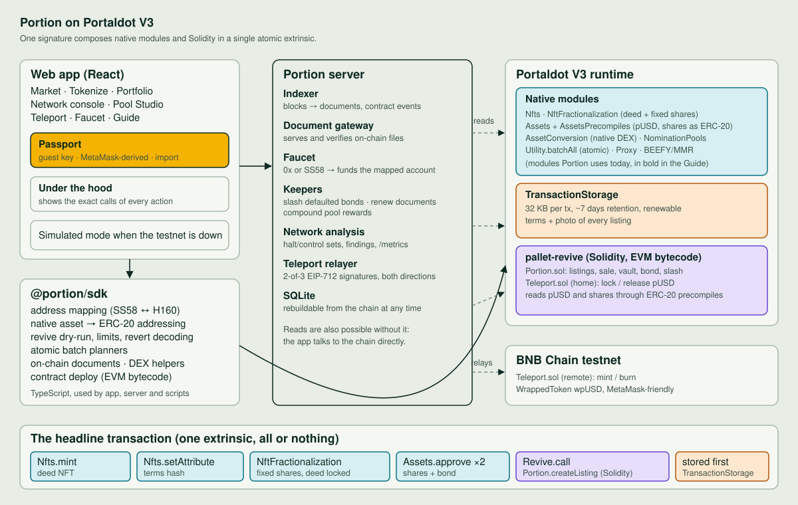

# Architecture

## Layers

| Layer | Where | Responsibility |
|---|---|---|
| Native modules | Portaldot runtime | The deed (`Nfts`), the fixed supply of shares (`NftFractionalization`), the tokens themselves (`Assets`), secondary trading (`AssetConversion`), staking pools (`NominationPools`), documents (`TransactionStorage`) |
| Solidity | `pallet-revive`, EVM bytecode | Accountability: primary sale, revenue vault, operator bond and slashing (`Portion.sol`), the bridge (`Teleport.sol`) |
| SDK | `packages/sdk` | Hides the two address worlds, sizes weights and deposits by dry-run, decodes reverts, builds atomic batches |
| Server | `packages/server` | Indexing, document gateway, faucet, keepers, network analysis, bridge relayer |
| App | `apps/web` | The product |

## Why each module is where it is

- **Shares are native assets, not an ERC-20 the operator deploys.** The runtime's `AssetsPrecompiles` module gives every native asset an ERC-20 address:
  `[assetId: 4 bytes][12 zero bytes][prefix: 2 bytes][2 zero bytes]` with prefix `0x0001` on this runtime. We found it by probing the live RPC (asset 1 answered `symbol()` with `TST`)
  and the SDK has a test pinning it. The Solidity contract therefore treats shares and pUSD as plain `IERC20` and the operator cannot ship a malicious token.
- **The deed is locked by the protocol.** `NftFractionalization.fractionalize` switches off transfers of the NFT and mints the shares with the *pallet* as the asset's only admin.
  `unify` returns the deed to whoever has gathered 100% of the shares. The server's proof endpoint checks all of this live, and the listing page shows it.
  Known limit: `pallet-nfts` lets an item's owner burn it; the proof then shows "the deed no longer exists".
- **One signature, many modules.** `Utility.batchAll` wraps the native calls and a `Revive.call` into Solidity. Failure anywhere reverts everything.
  `TransactionStorage.store` is *not* batched: the pallet indexes the tail of the extrinsic as the stored bytes, so it must be a top-level extrinsic.
- **Why a contract at all?** Accountability needs state machines that pallets do not provide off the shelf: a cadence clock, a bond, a permissionless slash, per-share revenue accounting.
  Solidity is the right tool and `pallet-revive` runs it with standard `solc` output (`evm_version = paris`).
- **Wallet-owned signing.** The web app connects to an injected Substrate-compatible browser wallet. The wallet shares public accounts and supplies a signer; native transactions are approved in that wallet. The app does not request recovery phrases, derive spending keys from MetaMask signatures, or restore/save browser secrets. Demo identities are memory-only and are never used for live transactions. The contract address mapping remains `keccak256(accountId)[12..]`, verified against `reviveApi.address`. Historical SDK key helpers remain for local development/legacy compatibility, not web sign-in.

## Chain facts this build depends on (all verified on the V3 testnet)

| Fact | Value |
|---|---|
| Runtime | `portaldot-v3` spec 3002, Polkadot SDK, ~70 pallets |
| Block time | 6 s, GRANDPA finality lag ~2 blocks |
| Chain id (EVM) | 420420777 |
| Decimals | 14 for tPOT, 6 for pUSD (our asset), 0 for shares |
| EVM bytecode | allowed (`Revive.AllowEVMBytecode = true`); constructor args go inside the code blob, `data` stays empty |
| Storage deposit | refundable, `0.06 tPOT` per byte of code and `0.15 tPOT` per storage item, so Portion costs about 900 tPOT of float to deploy |
| `TransactionStorage` | `MaxTransactionSize` 32,768 bytes, retention 100,800 blocks |
| Validators | 2, equal stake, 0 nominators, 0 DEX pools, 0 nomination pools at the time of the research |

## Data flow of the headline transaction

1. Browser compresses the photo to under 28 KB and builds the terms JSON.
2. The connected wallet approves two top-level `TransactionStorage.store` extrinsics (terms, photo).
3. SDK picks a free asset id and NFT item, then builds the batch.
4. The connected wallet approves `batchAll[ mint, setAttribute, fractionalize, approve shares, approve bond, Portion.createListing ]`.
5. `createListing` checks `totalSupply()` of the share token equals the declared supply, pulls shares and bond with the approvals, and emits `Listed`.
6. The indexer stores the documents it sees in the block bodies and the event; the app shows the listing.

## Closing rules

An operator cannot wind down while any shares remain staked in the revenue vault. An overdue bond must be slashed before an empty vault can close. After closure, new stakes and bond top-ups are rejected; previously earned claims remain payable. Unstaking returns tokens, not purchase principal. This conservative prototype rule can lock the operator bond until all stakers leave; it is not a complete real-world settlement or redemption design.

## Security notes

- `Portion` uses a reentrancy lock, pull-payment accounting (`accPerShare`, 1e18 precision) and checks-effects-interactions. Foundry tests include a 512-run solvency fuzz.
- `Teleport` verifies EIP-712 signatures bound to destination chain and contract, rejects malleable signatures and duplicate/unsorted signers, blocks replays by `(srcChain, nonce)`,
  and has per-transfer and daily caps plus a pause switch. The relayer committee is a disclosed v0 trust assumption.
- Operator revenue is self-reported. The bond and cadence rules make non-payment visible and expensive; they do not prove revenue.
- Nothing here has been audited. It is hackathon testnet software.
